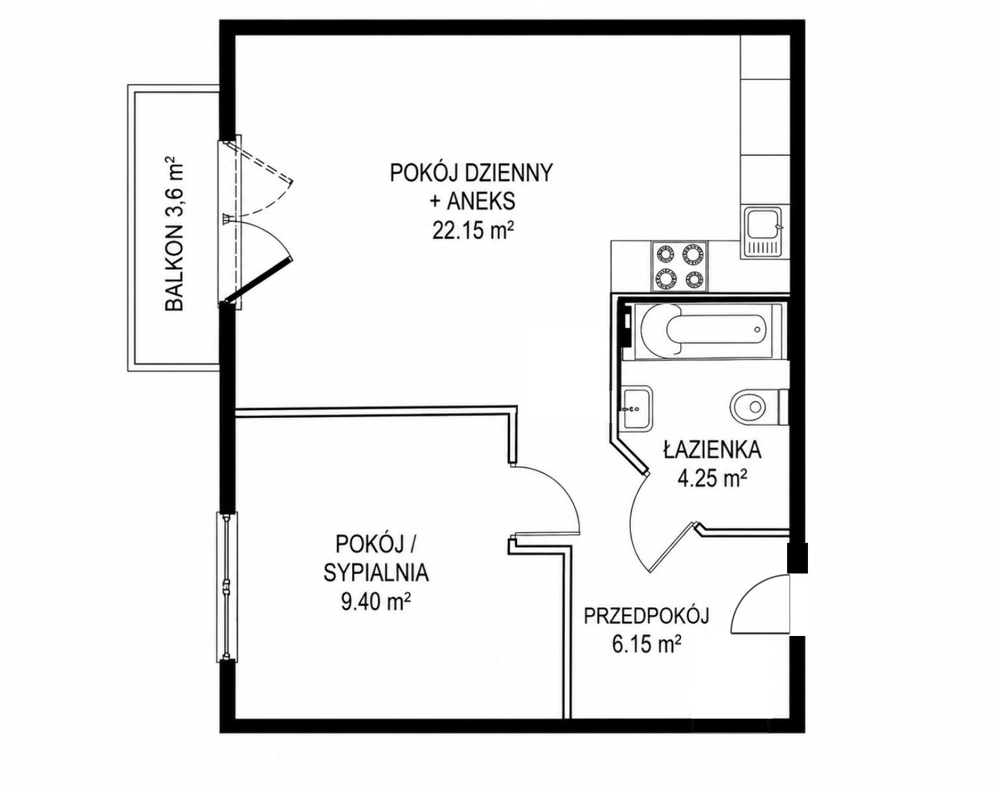

# Mieszkanie na sprzedaż — Gdańsk, ul. Myśliwska

## Najważniejsze informacje

- Lokalizacja: Gdańsk, Piecki-Migowo / Morena, ul. Myśliwska
- Osiedle: Klimaty 2
- Rodzaj nieruchomości: mieszkanie 2-pokojowe
- Powierzchnia użytkowa: 41,95 m²
- Piętro: 1. piętro w 4-piętrowym budynku
- Winda: tak
- Rok budowy: 2017
- Balkon: 3,60 m²
- Komórka lokatorska: 2,85 m²
- Miejsce postojowe: hala garażowa pod budynkiem
- Ekspozycja: wschodnio-południowa
- Stan: bardzo dobry, mieszkanie gotowe do zamieszkania
- Dostępność: od zaraz
- Forma sprzedaży: bezpośrednio od właściciela, bez pośredników

## Cena

- Cena mieszkania: **700 000 zł**
- Miejsce postojowe w garażu podziemnym: **55 000 zł**
- Komórka lokatorska 2,85 m²: **15 000 zł**
- Łączna cena zakupu: **770 000 zł**
- Zakup miejsca postojowego i komórki lokatorskiej jest obligatoryjny.
- Meble oraz sprzęt AGD widoczne na zdjęciach pozostają w cenie mieszkania.
- Brak prowizji pośrednika. Szacowana oszczędność dla kupującego: około 21 000 zł.

## Rozkład pomieszczeń

- Pokój dzienny z aneksem kuchennym: 22,15 m²
- Sypialnia: 9,40 m²
- Łazienka: 4,25 m²
- Przedpokój: 6,15 m²
- Łączna powierzchnia użytkowa: 41,95 m²
- Balkon dostępny z pokoju dziennego: 3,60 m²

## Rzut mieszkania

## Standard wykończenia i wyposażenie

- Podłogi wykonane z wysokiej jakości trójwarstwowej deski dębowej.
- Solidne, naturalne drzwi sosnowe.
- Okna PVC.
- Trzydrzwiowa szafa w zabudowie w przedpokoju, wykonana do sufitu.
- Dwudrzwiowa szafa w zabudowie w sypialni, wykonana do sufitu.
- Aneks kuchenny z zabudową.
- Wyposażenie obejmuje między innymi lodówkę, piekarnik, zmywarkę i kuchenkę.
- Meble i sprzęt AGD widoczne na zdjęciach są zawarte w cenie.

## Układ i charakter mieszkania

Mieszkanie ma funkcjonalny układ bez zbędnych przejść. Duży salon z aneksem kuchennym prowadzi na balkon, a osobna sypialnia zapewnia prywatność. Wschodnio-południowa ekspozycja dobrze doświetla wnętrza. Wysokie zabudowy w przedpokoju i sypialni zapewniają dużo miejsca do przechowywania.

## Budynek i osiedle

- Kameralny, 4-piętrowy budynek z windą.
- Budynek oddany do użytkowania w 2017 roku.
- Zadbane, spokojne i pełne zieleni Osiedle Klimaty 2.
- Plac zabaw na osiedlu.
- Miejsce postojowe znajduje się w podziemnej hali garażowej.

## Stan prawny, dokumenty i opłaty

- Pełna, odrębna własność z Księgą Wieczystą.
- Księga Wieczysta bez obciążeń.
- Świadectwo energetyczne jest dostępne dla nieruchomości.
- Czynsz administracyjny: około 650 zł miesięcznie.
- Mieszkanie dostępne od zaraz.

## Lokalizacja i infrastruktura

Wszystkie podane czasy są orientacyjne.

- Paczkomaty, fryzjer i barber: około 3 minuty spacerem.
- Sklep Żabka: około 4 minuty spacerem.
- Przystanek autobusowy: około 4 minuty spacerem.
- Centrum Handlowe Viktor: około 5 minut spacerem. Na miejscu między innymi Biedronka, apteka, sklep mięsny, piekarnia, Rossmann, Pepco i punkty gastronomiczne.
- Staw Wróbla i przyległy las: około 7 minut spacerem.
- Stacja PKM Jasień i zbiornik Jasień: około 13 minut spacerem.
- Wjazd na Obwodnicę Trójmiasta: około 5 minut samochodem.

## Warunki sprzedaży

- Oferta prywatna, bezpośrednio od właściciela.
- Właściciel nie jest zainteresowany współpracą z agencjami nieruchomości ani publikacją oferty przez pośredników.
- Kupujący może skorzystać z pomocy wybranego przez siebie agenta, jeśli potrzebuje wsparcia przy zakupie.

## Kontakt

- Telefon: **797 961 732**
- Strona oferty: <https://bartas93.github.io/sprzedam/>

---

Niniejszy opis ma charakter informacyjny i nie stanowi oferty w rozumieniu Kodeksu cywilnego.

Stan informacji: 14 września 2026 r.
